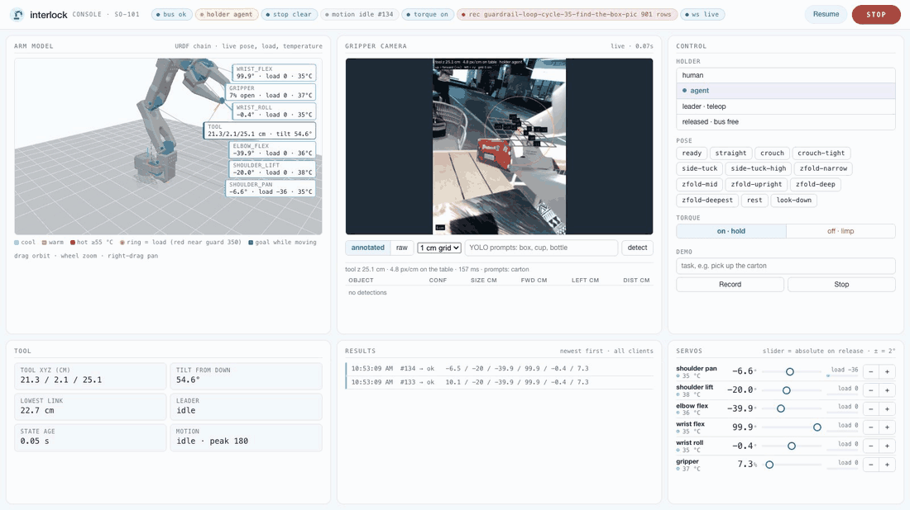
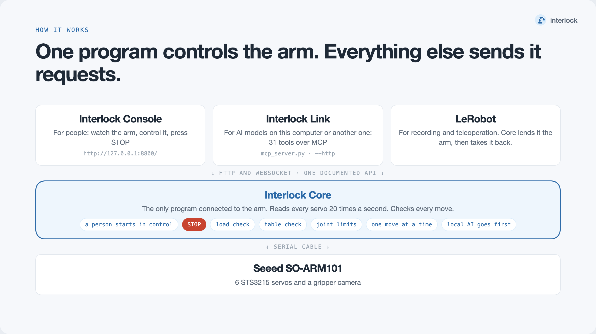

# Interlock Controller

Guarded control of a [Seeed SO-101](https://wiki.seeedstudio.com/lerobot_so100m/) robot arm for AI
agents, with a human in the loop.

One process, **arm-daemon**, owns the arm's serial bus. Everything else is a client of its HTTP
API: a human dashboard (the *Interlock Console*), an MCP server for AI agents (local over stdio,
remote over HTTP with a bearer token), and teleop from a leader arm. The human always holds the
key: an agent can only move the arm while the human has handed it control, and STOP works for
anyone.



*The Interlock Console, recorded while an AI agent ran a guardrail-loop round on its own.*

## What is in here

| Path | What |
|---|---|
| `arm-daemon/daemon.py`, `api.py`, `bus.py`, `ctrl.py` | The bus owner: servo polling, writes, holder/control model, STOP/resume |
| `arm-daemon/guards.py` | Joint-limit clamp, load/lag freeze, table clearance |
| `arm-daemon/mcp_server.py` | Agent MCP server (`--http` for agents on other machines) |
| `arm-daemon/skills.py` | Agent-side skills: observe, IK moves, align, grasp, evaluate, replan |
| `arm-daemon/cameras.py`, `camview.py`, `jawband.py`, `vision_worker.py` | Gripper camera proxy and the annotated view agents decide from |
| `arm-daemon/demolib.py`, `teleop-record.py`, `record-frames.py` | Demonstration recording, skill cards, replay |
| `arm-daemon/dashboard.html` | The Interlock Console (human dashboard) |
| `arm-daemon/API.md` | Full API, control model and tool reference |
| `arm-daemon/tests/` | pytest suite, runs against a fake bus and fake camera |
| `.claude/skills/` | Agent skills for driving the arm and naming postures |
| `lab/arm-vision/*.json` | Camera calibration, jaw signature and pose library |
| `docs/`, `reports/robot-ai-practices/` | Design spec, plans, handoffs, and run analyses |

## How it fits together



## Control model, in short

- The holder is `human`, `agent`, `leader` or `released`. It starts as `human` on every daemon start.
- Only requests carrying the human key (`human.key`, created on first start, mode 600) can change
  the holder. Agent writes while the human holds control are refused.
- Every write returns `ok`, `frozen` (a guard stopped it on contact or load) or `refused` (nothing
  moved), with a reason.
- A local agent goes first and can stop a remote agent's move; the dashboard can block the remote
  agent entirely.

Details: [`arm-daemon/API.md`](arm-daemon/API.md).

## Status

This is a working snapshot of a hackathon project, not a packaged release. Some runtime pieces
live outside this repo and are not included: the launcher scripts, the dashboard's 3D view assets,
the kinematics and camera-calibration modules shared with `arm-agent`, model weights, and recorded
demos. Read the code and docs for the design; expect to fill those gaps to run it on your own arm.

Hardware it was built on: SO-101 follower and leader arms (Feetech STS3215 servos), a gripper
camera, macOS.

## Tests

```bash
cd arm-daemon && uv run pytest
```

## License

[Fair Profit License (FPL) v2.0](./LICENSE). Non-commercial use is free, perpetual and
irrevocable. Commercial use has three paths:

- **Path A, Full Transparency** (zero cost): open-source all derivatives and publish annual
  financial statements.
- **Path B, Traditional Commercial License** (paid): private code and financials, fee tier based on
  attributable revenue.
- **Path C, Deep Funding** (paid, ecosystem-first): same fee as Path B, 100% routed to
  dependencies and public goods.

See [LICENSE](./LICENSE) for the full text.
